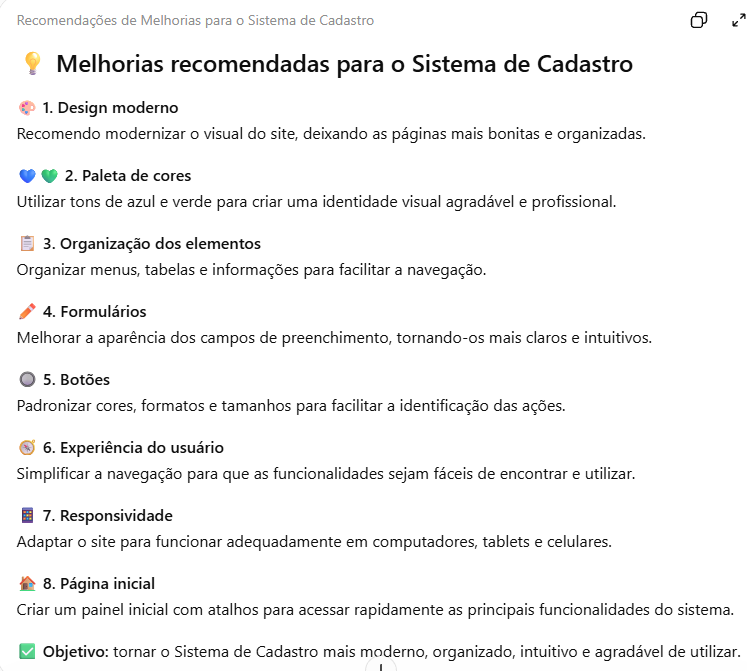
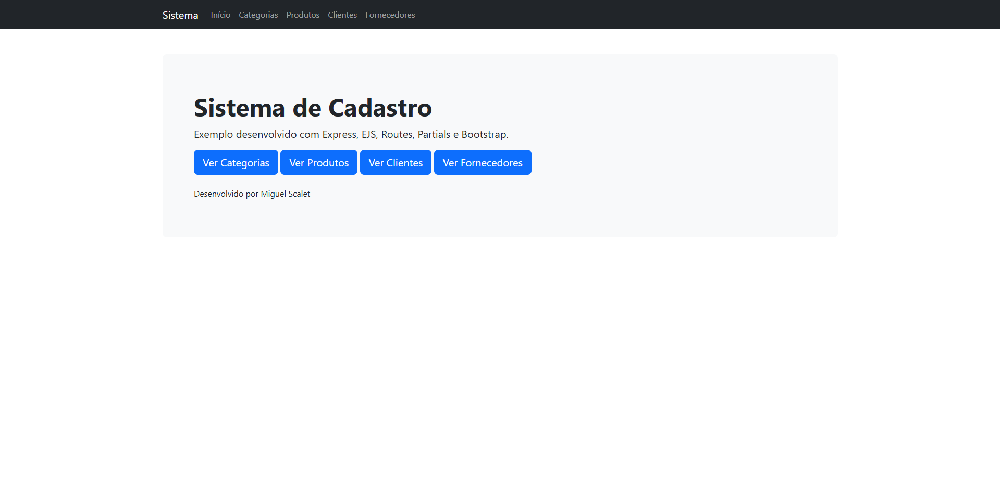
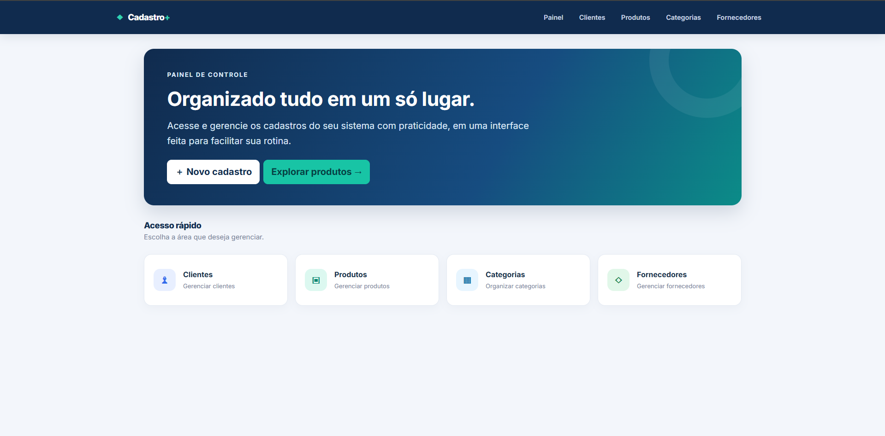

Nome do Projeto:_navjs

Integrantes: 
Miguel Scalet

Objetivo:
Sistemas de cadastro onde você pode codastrar categorias, produtos, clientes e fornecedores dentro de um estabelecimento

Tecnologias Utilizadas:
CRUD, node.js, Express, ChatGPT e Gemini

Funcionalidades: 
possibilita cadastrar, ler e modificar

Prompt Utilizado: 
Chat
estou fazendo um projeto/site de Cadastro
eu quero que você me ajude com as seguintes mudanças:
- Layout mais moderno;
- Melhor organização dos elementos;
- Melhor uso de cores;
- Botões e formulários aprimorados;
- Melhor experiência para o usuário;
- Responsividade (quando possível).

eu gostaria do site com uma palheta de cor puxada pro azul com verde
eu preciso que você siga essa regras,
se tiver alguma outra coisa para melhorar me explique antes.
Uso da Inteligência Artificial: Sim

Alterações Sugeridas pela IA: 
- Cabeçalho com o nome do sistema.
- Menu de navegação mais moderno.
- Apresentação inicial com um título e uma descrição.
- Quatro cartões para Clientes, Produtos, Categorias e Fornecedores.
- Ícones para facilitar a identificação de cada seção.
- Botões com cores padronizadas.
- Melhor espaçamento entre os elementos.
A ideia é que o usuário consiga identificar rapidamente onde precisa clicar.

Alterações Implementadas pelo Grupo: 
Eu fiz alterações em todas as rotas (clientes, fornecedores, categorias, produtos e na pagiana inicial) deixando tudo mais moderno
e com uma palheta decores com destaque no azul e detalhes em verde com o botão Excluir sem vermelho para destaque.  
Mudei varios erros que a IA cometeu, erros bobos como mudar o sentido de um texto ou frase.

Prints da Conversa com a IA:

Antes da Reestilização:

Depois da Reestilização:

Link da Aplicação:

Link do Repositório:
https://github.com/miguelscalet2000-hue/navjs_atualizado
